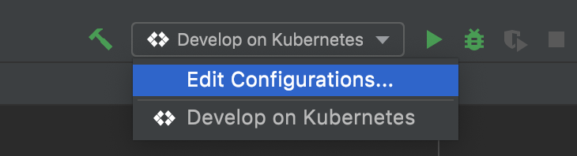
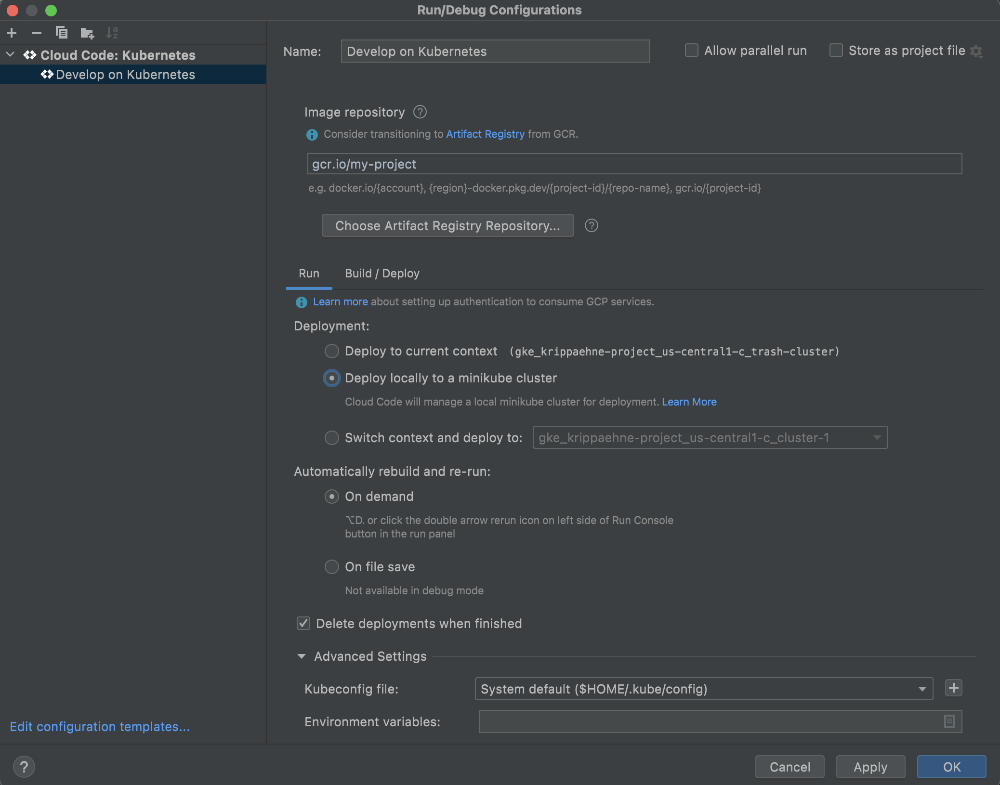
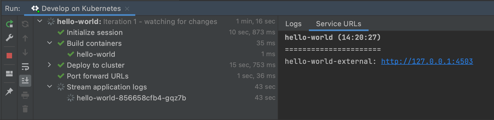
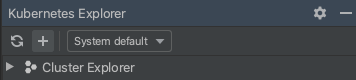
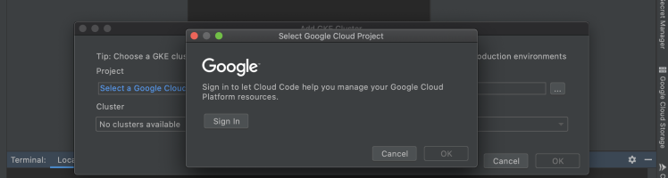
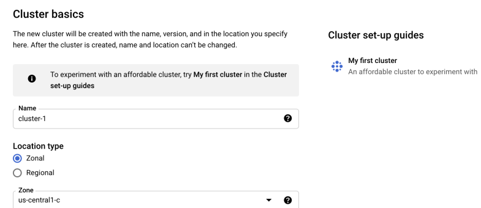
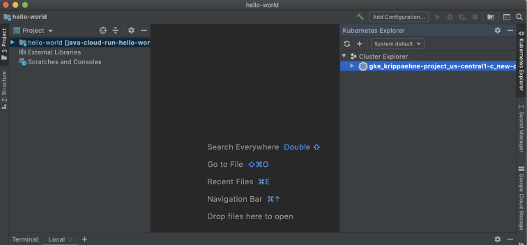

# Transport Booking Agent (IntelliJ Guide)

This guide provides instructions for developing and deploying the Transport Booking Agent application using the Cloud Code extension for IntelliJ. The Transport Booking Agent is an AI-powered multi-agent system for booking transport, with its full technical specification detailed in `docs/SPEC.md`. When you run the application, Cloud Code uses [skaffold](https://skaffold.dev/docs/) under the hood to build an image and deploy the project's Kubernetes manifests. To learn more about Kubernetes, explore the [Kubernetes overview](https://kubernetes.io/docs/concepts/overview/).

### Table of Contents
* [What's in this sample](#whats-in-this-sample)
* [Getting Started](#getting-started)
    1. [Run the app locally with minikube](#run-the-app-locally-with-minikube)
        * [Edit run configuration](#edit-run-configuration)
        * [Run the app on minikube](#run-the-app-on-minikube)
    2. [Run the app remotely with Google Kubernetes Engine](#run-the-app-remotely-with-google-kubernetes-engine)
        * [Set up a GKE cluster](#set-up-a-gke-cluster)
        * [Deploy app to GKE](#deploy-app-to-gke)
* [Next steps](#next-steps)

---
<h2 id="whats-in-this-sample"> What's in this sample </h2>

<h3 id="kubernetes-architecture"> Kubernetes architecture </h3>

<h3 id="directory-contents"> Directory contents </h3>

- `kubernetes-manifests/` - Contains Kubernetes YAML files for the Transport Booking Agent services and deployments, including:

  - `transport-booking-agent.deployment.yaml` - deploys a pod with the 'transport-booking-agent' container image
  - `transport-booking-agent.service.yaml` - creates a load balancer and exposes the 'transport-booking-agent' service on an external IP in the cluster

---
<h2 id="getting-started"> Getting Started </h2>

<h3 id="run-the-app-locally-with-minikube"> Run the app locally with minikube </h3>

<h4 id="edit-run-configuration"> Edit run configuration </h4>

1. Click the configuration dropdown in the top taskbar and then click **Edit Configurations**.

   The **Develop on Kubernetes** configuration watches for changes, then uses [skaffold](https://skaffold.dev/docs/) to rebuild and rerun your app. You can customize your deployment by making changes to this run configuration or by creating a new Cloud Code: Kubernetes run configuration.

3. Under **Run > Deployment**, select 'Deploy locally to a minikube cluster'.

4. Click **OK** to save your configuration.

<h4 id="run-the-app-on-minikube"> Run the app on minikube </h4>

1. Select **Develop on Kubernetes** from the configuration dropdown and click the run icon. Cloud Code runs your app in a local [minikube](ttps://minikube.sigs.k8s.io/docs/start/) cluster.

2. View the build process in the output window. When the deployment is successful, you're notified that new service URLs are available. Click the Service URLs tab to view the URL(s), then click the URL link to open your browser with your running application.  

3. To stop the application, click the stop icon next to the configuration dropdown.

---
<h3 id="run-the-app-remotely-with-google-kubernetes-engine"> Run the app remotely with Google Kubernetes Engine </h3>

<h4 id="set-up-a-gke-cluster"> Set up a GKE cluster </h4>

1. Navigate to the Kubernetes Explorer from the right side panel, or by going to **Tools > Cloud Code > Kubernetes > View Cluster Explorer**. 

2. Click **+** to create a new cluster, or go to **Tools > Cloud Code > Kubernetes > Add GKE Cluster**.  

3. If prompted, log in to your GCP account and select a project.  

4. Click **Create a new GKE cluster**. You will be directed to the Google Cloud Console to create your new cluster.  

5. Once your GKE cluster has been created, it will be displayed in the Cluster Explorer.  

6. Your new cluster will be set as the current context by default. To switch contexts, right click on a different cluster in the Cluster Explorer and select **Set as Current Context**. 

<h4 id="deploy-app-to-gke"> Deploy app to GKE </h4>

1. Select **Develop on Kubernetes** from the configuration dropdown and click the run icon. 

2. View the build process in the output window. When the deployment is successful, you're notified that new service URLs are available. Click the Service URLs tab to view the URL(s), then click the URL link to open your browser with your running application.  

3. To stop the application, click the stop icon next to the configuration dropdown.

---
<h2 id="next-steps"> Next steps </h2>

* Try [debugging your app](https://cloud.google.com/code/docs/intellij/kubernetes-debugging?utm_source=ext&utm_medium=partner&utm_campaign=CDR_kri_gcp_cloudcodereadmes_012521&utm_content=-) using Cloud Code
* Navigate the [Kubernetes Engine Explorer](https://cloud.google.com/code/docs/intellij/using-the-kubernetes-explorer?utm_source=ext&utm_medium=partner&utm_campaign=CDR_kri_gcp_cloudcodereadmes_012521&utm_content=-)
* Learn how to [edit YAML files](https://cloud.google.com/code/docs/intellij/yaml-editing?utm_source=ext&utm_medium=partner&utm_campaign=CDR_kri_gcp_cloudcodereadmes_012521&utm_content=-) to deploy your Kubernetes app
* [Configure an existing app](https://cloud.google.com/code/docs/intellij/using-a-k8-existing-app?utm_source=ext&utm_medium=partner&utm_campaign=CDR_kri_gcp_cloudcodereadmes_012521&utm_content=-) to run on Cloud Code
* Enable [Cloud APIs and client libraries](https://cloud.google.com/code/docs/intellij/client-libraries?utm_source=ext&utm_medium=partner&utm_campaign=CDR_kri_gcp_cloudcodereadmes_012521&utm_content=-)
* Manage secrets with [Secret Manager](https://cloud.google.com/code/docs/intellij/secret-manager?utm_source=ext&utm_medium=partner&utm_campaign=CDR_kri_gcp_cloudcodereadmes_012521&utm_content=-)

For more Cloud Code tutorials and resources, check out [Awesome Cloud Code](https://github.com/russwolf/awesome-cloudclode)!

