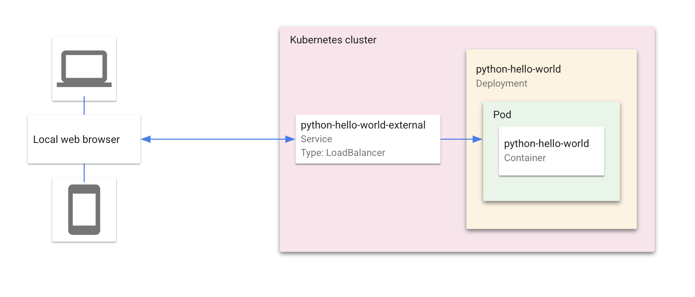
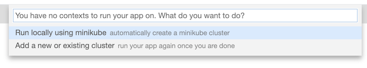
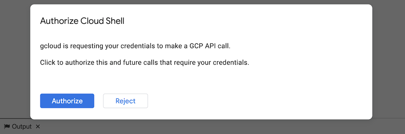
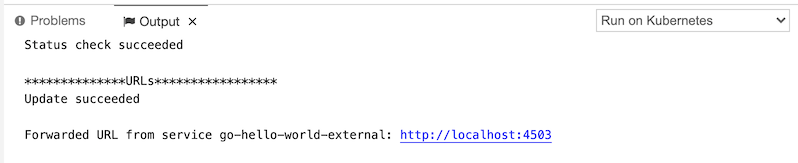
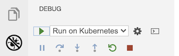
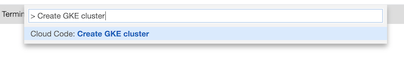
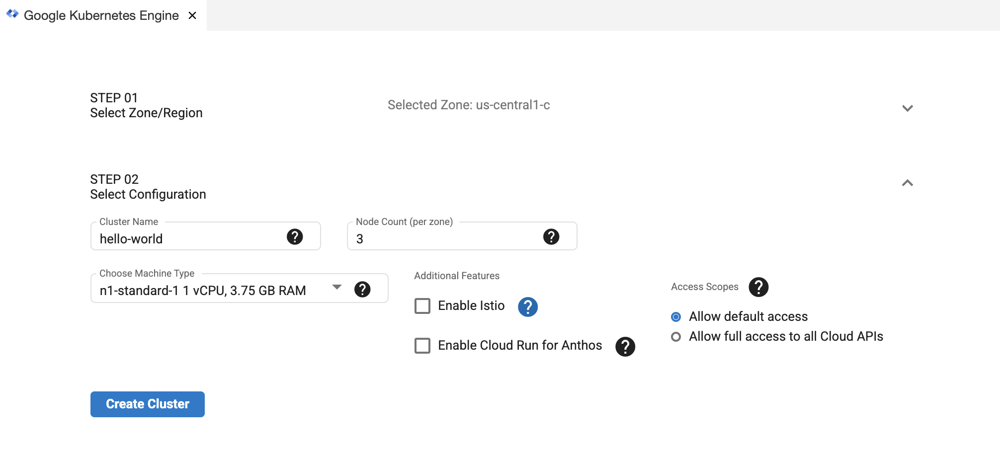
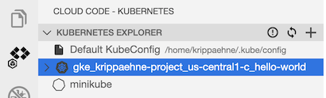
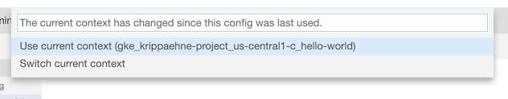

# Transport Booking Agent (Theia/Cloud Shell Guide)

This guide provides instructions for developing and deploying the Transport Booking Agent application using the Cloud Code extension for Cloud Shell. The Transport Booking Agent is an AI-powered multi-agent system for booking transport, with its full technical specification detailed in `docs/SPEC.md`. When you run the application, Cloud Code uses [skaffold](https://skaffold.dev/docs/) under the hood to build an image and deploy the project's Kubernetes manifests. To learn more about Kubernetes, explore the [Kubernetes overview](https://kubernetes.io/docs/concepts/overview/).
### Table of Contents
* [What's in this sample](#whats-in-this-sample)
* [Getting Started](#getting-started)
    1. [Run the app locally with minikube](#run-the-app-locally-with-minikube)
    2. [Run the app remotely with Google Kubernetes Engine](#run-the-app-remotely-with-google-kubernetes-engine)
        * [Set up a GKE cluster](#set-up-a-gke-cluster)
        * [Deploy app to GKE](#deploy-app-to-gke)

---
## What's in this sample
### Kubernetes architecture

<h3 id="directory-contents"> Directory contents </h3>

- `kubernetes-manifests/` - Contains Kubernetes YAML files for the Transport Booking Agent services and deployments, including:

  - `transport-booking-agent.deployment.yaml` - deploys a pod with the 'transport-booking-agent' container image
  - `transport-booking-agent.service.yaml` - creates a load balancer and exposes the 'transport-booking-agent' service on an external IP in the cluster

---
## Getting Started

### Run the app locally with minikube

1. To run your application, click on the Cloud Code status bar and select ‘Run on Kubernetes’.  
 

2. Select ‘Run locally using minikube’ when prompted. Cloud Code runs your app in a local [minikube](https://minikube.sigs.k8s.io/docs/start/) cluster.  

3. If prompted, authorize Cloud Shell to use your credentials to make a GCP API call.  

4. View the build progress in the OUTPUT window. Once the build has finished, click on the URL in the OUTPUT window to view your live application.  

5.  To stop the application, click the stop icon in the Debug Explorer.  

---
### Run the app remotely on Google Kubernetes Engine

#### Set up a GKE cluster

1. From the command palette, run 'Create GKE cluster'.  

2. Configure your new cluster using the GKE wizard and click 'Create Cluster'. Once your cluster has been created, it will be displayed in the Google Kubernetes Engine Explorer.  

3. Your new cluster will be set as the active cluster by default. To switch clusters, right click on a different cluster in the GKE Explorer and select 'Set as Active Cluster'.  

#### Deploy app to GKE

1. Click on the Cloud Code status bar and select ‘Run on Kubernetes’.

2. If prompted, confirm the current context and image registry.  

3. View the build’s progress in the OUTPUT window. Once the build has finished, you can visit your deployed app by clicking the URL in the OUTPUT window.  

