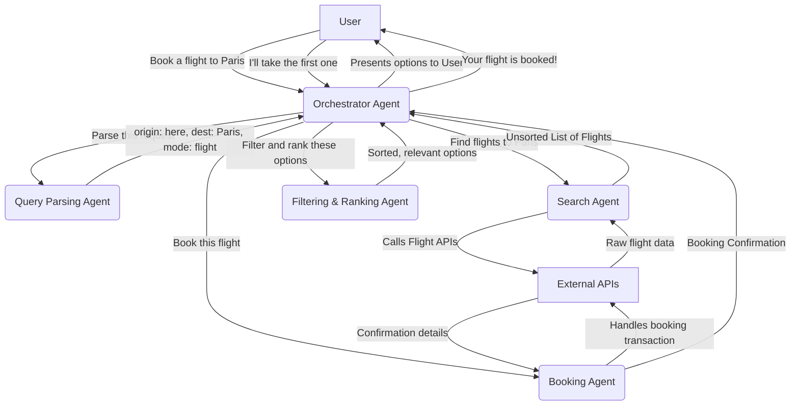

# Transport Booking Agent

This project implements an AI-powered Transport Booking Agent using a multi-agent architecture, as detailed in `docs/SPEC.md`. The agent system coordinates various specialized agents to fulfill user requests for booking transport.

## Features

*   **Multi-Agent Architecture**: A central Orchestrator Agent delegates tasks to specialized agents for query parsing, searching, filtering, ranking, booking, and user profile management.
*   **FastAPI Web Server**: Provides a web interface for user interaction and an API for chat functionality.
*   **Kubernetes Deployment**: Designed for deployment on Google Kubernetes Engine (GKE) using provided Kubernetes manifests.

## System Architecture

The system utilizes a multi-agent architecture managed by a central **Orchestrator Agent**.

### Data Flow Overview



### Kubernetes Infrastructure

The application is deployed on Google Kubernetes Engine.

```mermaid
graph TD
    subgraph "User's Device"
        A[Web Browser]
    end

    subgraph "Google Kubernetes Engine Cluster"
        B[transport-booking-agent-external Service (Type: LoadBalancer)]
        D[transport-booking-agent Deployment]

        subgraph "Pod(s)"
          C[transport-booking-agent Container]
        end

        subgraph "Container Details"
            E[FastAPI Web Server]
            G["/ (index.html)"]
            H["/chat (API)"]
        end
    end

    A -- "HTTPS Request" --> B
    D -- "Manages Pod Replicas" --> C
    B -- "Routes Port 80 to 8080" --> C
    C -- "Runs" --> E
    E -- "Serves" --> G
    E -- "Handles" --> H
```

## Directory Contents

*   `app.py`: The main FastAPI application entry point.
*   `requirements.txt`: Python dependencies for the project.
*   `agents/`: Contains the implementation of various specialized agents (e.g., `QueryParsingAgent`, `SearchAgent`, `OrchestratorAgent`).
*   `templates/`: HTML templates served by the FastAPI application (e.g., `index.html`).
*   `kubernetes-manifests/`: Kubernetes YAML files for deploying the application:
    *   `transport-booking-agent.deployment.yaml`: Defines the Kubernetes Deployment for the FastAPI application.
    *   `transport-booking-agent.service.yaml`: Defines the Kubernetes Service (LoadBalancer) to expose the application externally.
*   `docs/SPEC.md`: Detailed technical specifications and architecture overview of the Transport Booking Agent.

## Getting Started (Local Development)

1.  **Clone the repository**:
    ```bash
    git clone <repository-url>
    cd transport-booking-agent
    ```
2.  **Create and activate a virtual environment**:
    ```bash
    python -m venv .venv
    ./.venv/Scripts/activate # On Windows
    source ./.venv/bin/activate # On macOS/Linux
    ```
3.  **Install dependencies**:
    ```bash
    pip install -r requirements.txt
    ```
4.  **Run the FastAPI application**:
    ```bash
    uvicorn app:app --host 0.0.0.0 --port 8080
    ```
    The application will be accessible at `http://localhost:8080`.

## Deployment to Kubernetes (GKE)

1.  **Build Docker Image**:
    ```bash
    docker build -t transport-booking-agent:latest .
    # Tag and push to your container registry (e.g., Google Container Registry)
    # docker tag transport-booking-agent:latest gcr.io/<YOUR_PROJECT_ID>/transport-booking-agent:latest
    # docker push gcr.io/<YOUR_PROJECT_ID>/transport-booking-agent:latest
    ```
    _Remember to replace `<YOUR_PROJECT_ID>` with your Google Cloud Project ID._

2.  **Apply Kubernetes Manifests**:
    ```bash
    kubectl apply -f kubernetes-manifests/
    ```

3.  **Access the Application**:
    Once deployed, get the external IP of the LoadBalancer service:
    ```bash
    kubectl get services transport-booking-agent-external
    ```
    Access the application using the `EXTERNAL-IP` shown in the output.
