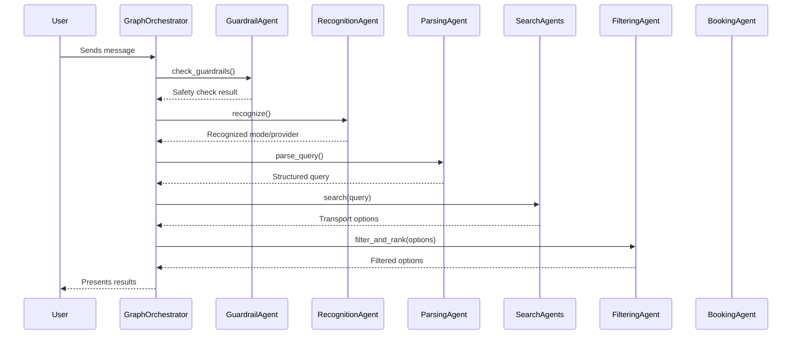

# Transport Booking Agent - Specification

## 1. Overview

The Transport Booking Agent is an AI-powered conversational agent designed to simplify the process of finding and booking transportation. Users can interact with the agent using natural language to search for flights, trains, buses, cabs, and bikes, and eventually book their preferred option.

## 2. Core Features

*   **Natural Language Understanding**: The agent can understand and process user requests in conversational language.
*   **Multi-Modal Transport Search**: It supports searching across various modes of transportation.
*   **User Preference Filtering**: Search results can be filtered and ranked based on user preferences like "cheapest" or "fastest".
*   **End-to-End Booking**: The agent can handle the entire booking process, from search to confirmation.
*   **Personalization**: Leverages user profiles to provide a personalized experience.
*   **Safety**: Includes guardrails to ensure safe and appropriate interactions.

## 3. Supported Transport Modes

The agent is capable of searching for and booking the following types of transport:
*   Flights
*   Trains
*   Buses
*   Cabs
*   Bikes

## 4. High-Level Architecture

The system is built around a central **Graph Orchestrator** that manages a workflow of specialized agents.

1.  **Input Processing**: The user's message is first checked by a **Guardrail Agent** for safety and then processed by a **Recognition Agent** to identify the transport mode and a **Parsing Agent** to extract key details (e.g., origin, destination).

2.  **Search**: The request is routed to the appropriate **Search Agent** (e.g., `FlightSearchAgent`, `CabSearchAgent`) which fetches available options from external APIs.

3.  **Filtering & Presentation**: The results are consolidated, filtered by a **Filtering Agent**, and presented to the user for selection.

4.  **Booking**: Once the user selects an option, the **Booking Agent** completes the transaction and provides a confirmation.

5.  **User Management**: A **User Profile Agent** maintains user data to personalize the experience and streamline bookings.

6.  **Authentication**: User identity is verified using Google OAuth 2.0. API requests are authenticated by validating a Google ID token sent in the `Authorization` header. This ensures that only authorized users can access the agent.

## 5. Data Flow

The typical data flow for a user request is as follows:

---

For more granular technical details, please refer to `IMPLEMENTATION_DETAILS.md`.