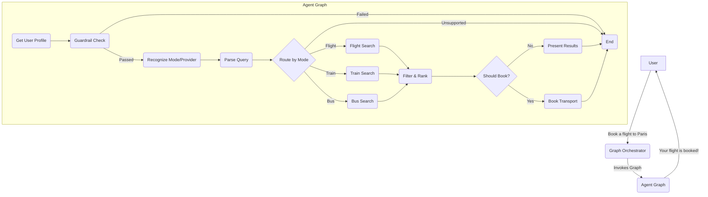
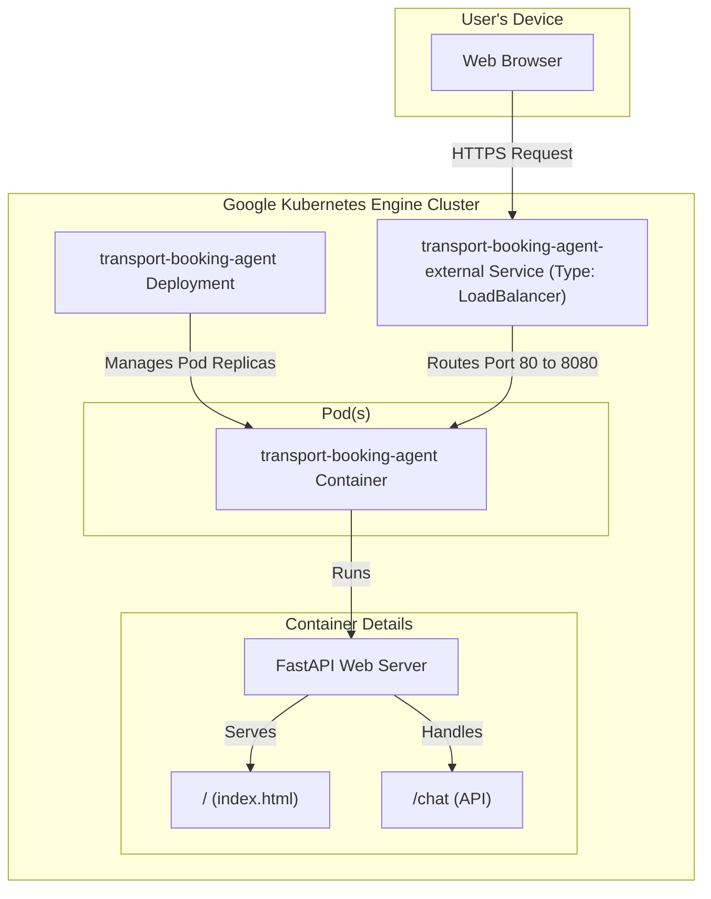

# Transport Booking Agent - Specification

This document outlines the high-level architecture for the AI-powered Transport Booking Agent. For detailed implementation specifics, please refer to [`IMPLEMENTATION_DETAILS.md`](./IMPLEMENTATION_DETAILS.md).

## 1. High-Level Architecture

The system uses a multi-agent architecture orchestrated by **Langgraph**. A central **GraphOrchestrator** manages a graph of specialized agents to fulfill a user's request.

### Data Flow



## 2. Agent Specifications

### 2.1. GraphOrchestrator
*   **Purpose**: The central coordinator. It uses a Langgraph graph to manage the flow of control between specialist agents.
*   **Input**: User's natural language message (string).
*   **Output**: A user-facing response message (string).
*   **Structure**: The graph's structure is defined in `src/transport_booking_agent/graph/orchestrator.py`, while the logic for each node in the graph resides in `src/transport_booking_agent/graph/nodes.py`.
*   **Logic**:
    1.  Initialize the agent graph.
    2.  The graph starts by getting the user profile and then checking the request against guardrails.
    3.  If guardrails pass, it recognizes the transport mode and provider.
    4.  It then routes to the appropriate search agent based on the recognized mode.
    5.  The rest of the flow for filtering, ranking, presenting results, and booking remains the same.

### 2.2. Guardrail Service
*   **Purpose**: To enforce safety and security policies.

### 2.3. Recognition Service
*   **Purpose**: To identify the transport mode and provider from the user's message.

### 2.4. Parsing Service
*   **Purpose**: To extract structured information from unstructured user text.

### 2.5. Search Services
*   **Purpose**: To find available transport options for a specific mode by interfacing with external APIs.

### 2.6. Filtering Service
*   **Purpose**: To refine and sort search results based on user preferences.

### 2.7. Booking Service
*   **Purpose**: To execute the final booking transaction.

### 2.8. User Profile Service
*   **Purpose**: To manage user data for personalization and history.

## 3. Data Models

### StructuredQuery (dict)
```json
{
  "origin": "string",
  "destination": "string",
  "date": "string",
  "passengers": "int",
  "mode": "string (flight, train, bus)",
  "preferences": "list[string] (e.g., 'cheapest', 'business class')"
}
```

### TransportOption (dict)
```json
{
  "type": "string (flight, train, bus)",
  "provider": "string (e.g., 'United Airlines')",
  "departure_time": "datetime",
  "arrival_time": "datetime",
  "price": "float",
  "booking_id": "string"
}
```

## 4. Infrastructure Architecture

This diagram shows the Kubernetes infrastructure setup for deploying the application.

