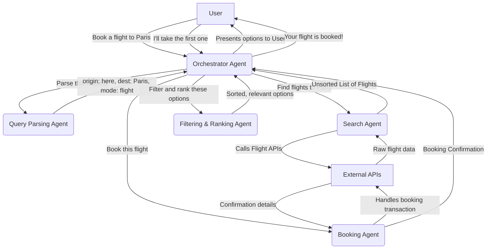
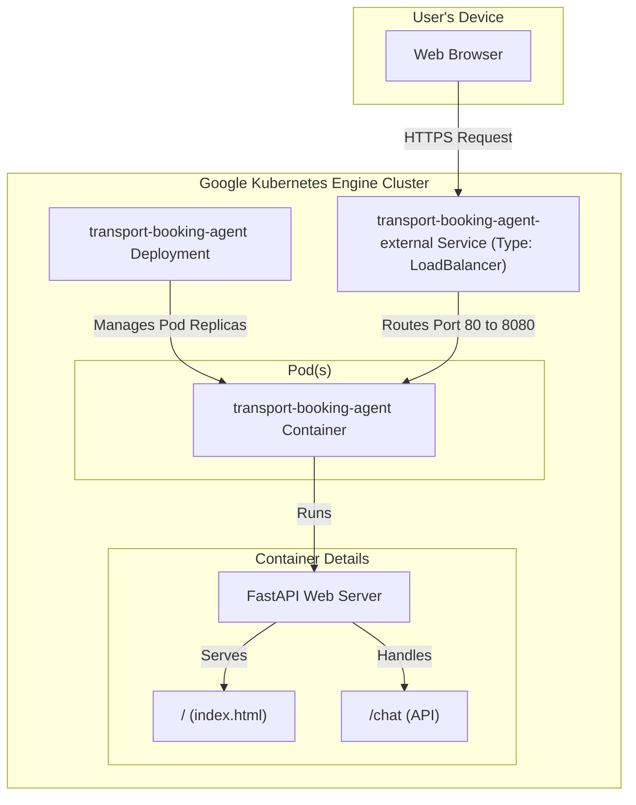

# Transport Booking Agent - Specification

This document outlines the architecture and technical specifications for the AI-powered Transport Booking Agent.

## 1. System Architecture

The system uses a multi-agent architecture where a central **Orchestrator Agent** manages a team of specialized agents to fulfill a user's request.

### Data Flow



## 2. Agent Specifications

### 2.1. Orchestrator Agent
*   **Purpose**: The central coordinator. It understands the overall goal, creates a plan, and delegates tasks to specialist agents.
*   **Input**: User's natural language message (string).
*   **Output**: A user-facing response message (string).
*   **Logic**:
    1.  Receive user message.
    2.  Delegate to `QueryParsingAgent` to structure the request.
    3.  Based on the structured query, delegate to `SearchAgent`.
    4.  Delegate to `Filtering & RankingAgent` to process search results.
    5.  Present results to the user.
    6.  If the user selects an option, delegate to `BookingAgent`.
    7.  Return a final confirmation to the user.

### 2.2. Query Parsing Agent
*   **Purpose**: To extract structured information from unstructured user text.
*   **Input**: A user's message (string).
*   **Output**: A `StructuredQuery` object.
*   **Example**: "I need a flight to Berlin for 2 people next Friday" -> `{ "origin": "current_location", "destination": "Berlin", "passengers": 2, "date": "next Friday", "mode": "flight" }`

### 2.3. Search Agent
*   **Purpose**: To find available transport options by interfacing with external APIs.
*   **Input**: A `StructuredQuery` object.
*   **Output**: A list of `TransportOption` objects.
*   **Tools**: API clients for flight, train, and bus services.

### 2.4. Filtering & Ranking Agent
*   **Purpose**: To refine and sort search results based on user preferences.
*   **Input**: A list of `TransportOption` objects and user preferences (e.g., "cheapest", "fastest").
*   **Output**: A sorted list of `TransportOption` objects.

### 2.5. Booking Agent
*   **Purpose**: To execute the final booking transaction.
*   **Input**: A specific `TransportOption` object and user details (name, payment info).
*   **Output**: A `BookingConfirmation` object.

### 2.6. User Profile Agent
*   **Purpose**: To manage user data for personalization and history.
*   **Input**: User ID.
*   **Output**: User preferences, past trips, and personal information.

## 3. Data Models

### StructuredQuery (dict)
```json
{
  "origin": "string",
  "destination": "string",
  "date": "string",
  "passengers": "int",
  "mode": "string (flight, train, bus)",
  "preferences": "list[string] (e.g., 'cheapest', 'business class')"
}
```

### TransportOption (dict)
```json
{
  "type": "string (flight, train, bus)",
  "provider": "string (e.g., 'United Airlines')",
  "departure_time": "datetime",
  "arrival_time": "datetime",
  "price": "float",
  "booking_id": "string"
}
```

## 4. Infrastructure Architecture

This diagram shows the Kubernetes infrastructure setup for deploying the application.

